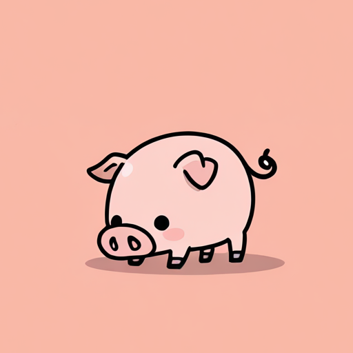
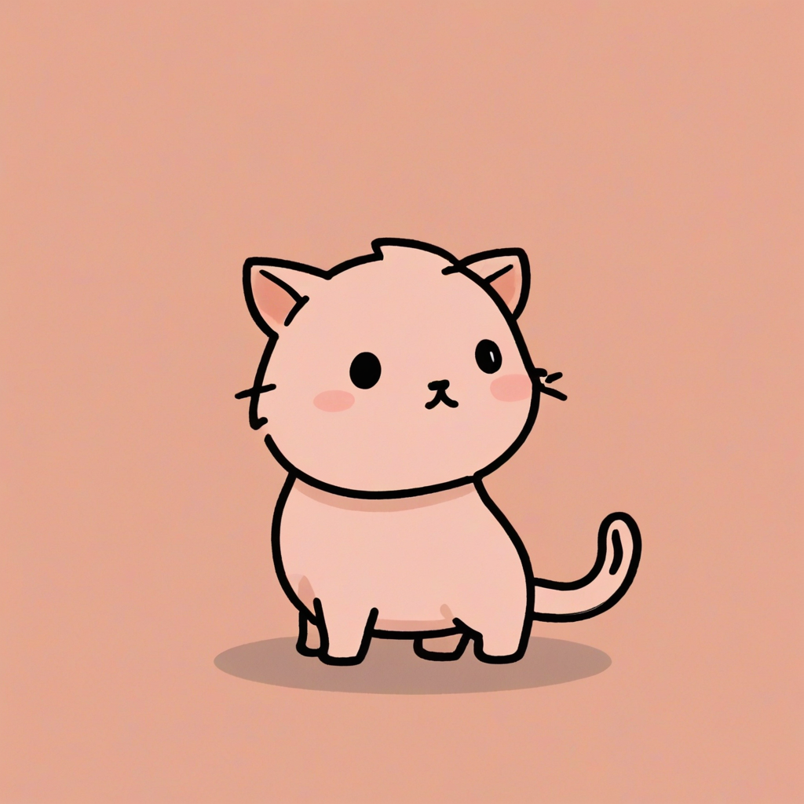
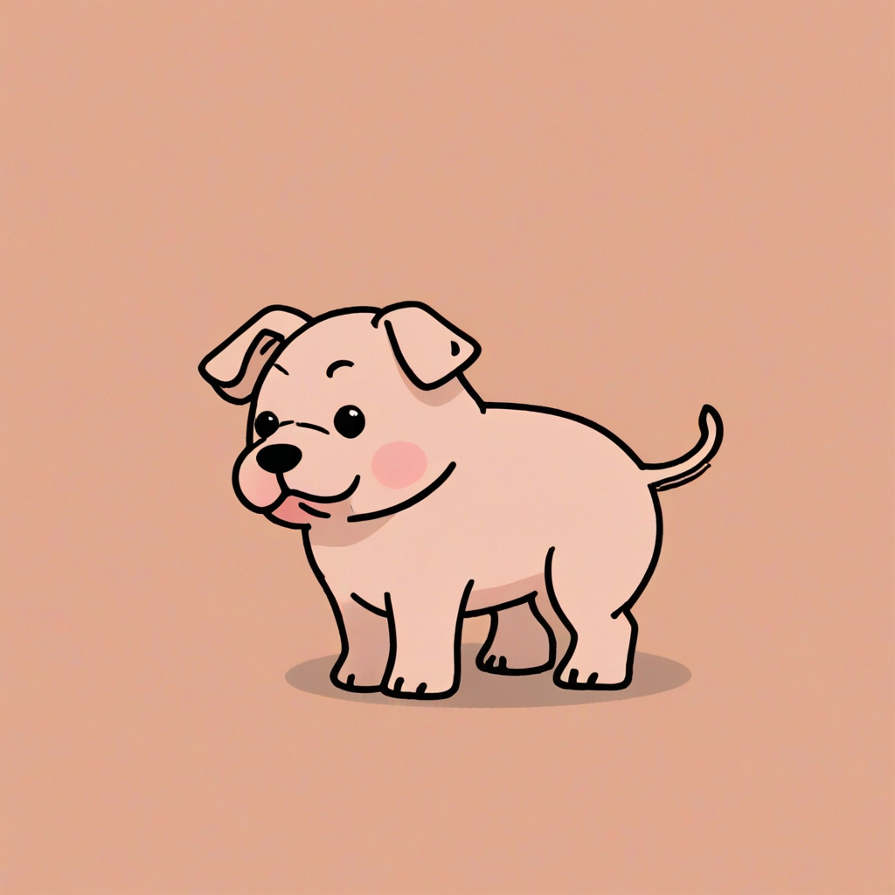
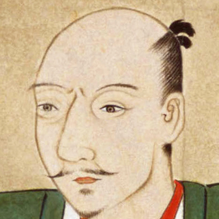
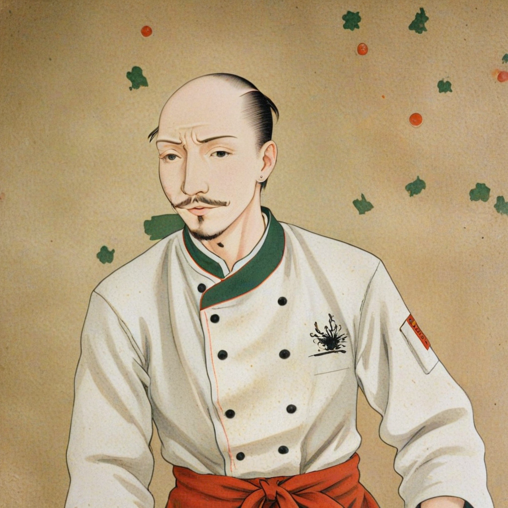
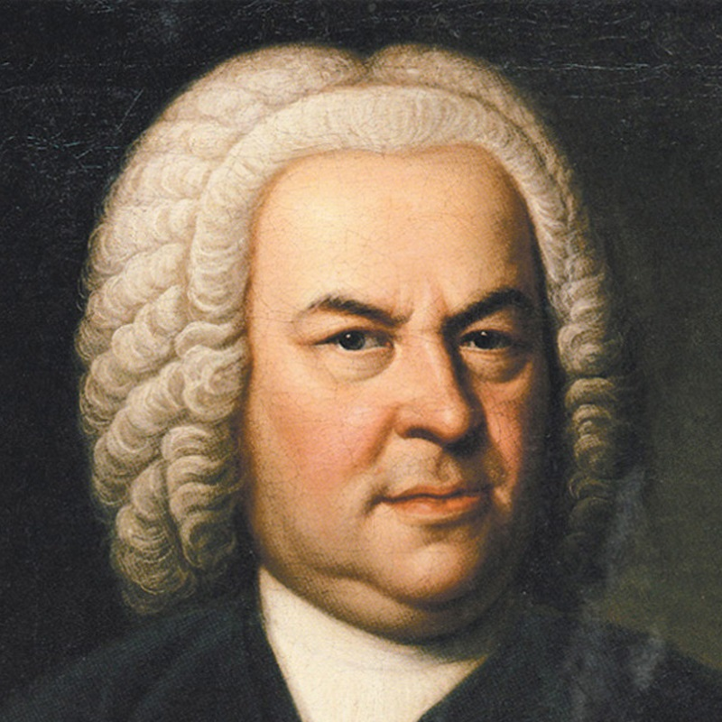
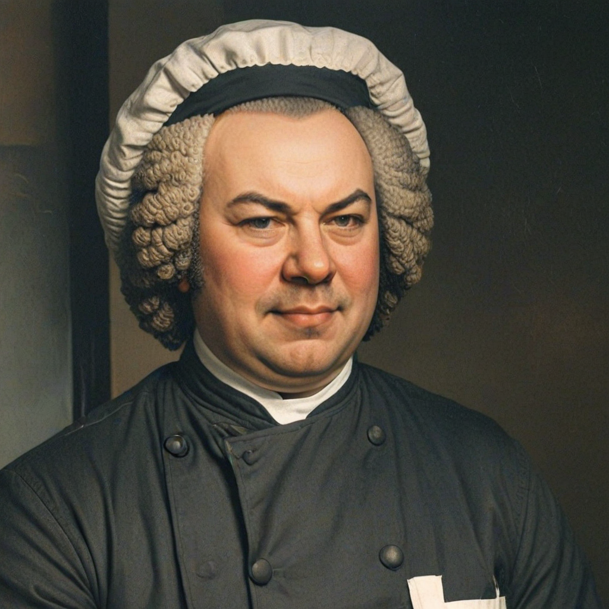

# [WIP] IP Adapter

[Experimental] Run SDXL pipeline with IP Adapter on NPU.

[https://huggingface.co/Buuta/ip-adapter-sdxl-for-Snapdragon-X-Elite](https://huggingface.co/Buuta/ip-adapter-sdxl-for-Snapdragon-X-Elite)

## Running the image generation with IP Adapter

### Setup

#### Download the Model

```bash
sdxlite-cli.bat setup --ip_adapter
```

### Execution Examples

#### IP Adapter Plus

**Input:**  


```bash
sdxlite-cli.bat txt2img --prompt "cat" --quantized_model --ip_adapter_image "buuta512.png" --ip_adapter_weight 0.65
```
**Output(Cat):**  


```bash
sdxlite-cli.bat txt2img --prompt "dog" --quantized_model --ip_adapter_image "buuta512.png" --ip_adapter_weight 0.65
```
**Output(Dog):**  


##### Key parameters
```
--ip_adapter_image "buuta512.png"
--ip_adapter_weight 0.65
```

---

#### IP Adapter Plus (Face)

**Input:**  

```bash
sdxlite-cli.bat txt2img --prompt "A photo of a chef" --quantized_model --ip_adapter_face_image "nobunaga_face.png" --ip_adapter_face_weight 1
```
**Output(Chef Nobunaga):**  


##### Key parameters
```
--ip_adapter_face_image "nobunaga_face.png"
--ip_adapter_face_weight 1
```

---

**Input:**  

```bash
sdxlite-cli.bat txt2img --prompt "A photo of a chef" --quantized_model --ip_adapter_face_image "Johann_Sebastian_Bach.png" --ip_adapter_face_weight 0.8
```
**Output(Chef Bach):**  


##### Key parameters
```
--ip_adapter_face_image "Johann_Sebastian_Bach.png"
--ip_adapter_face_weight 0.8
```

---

